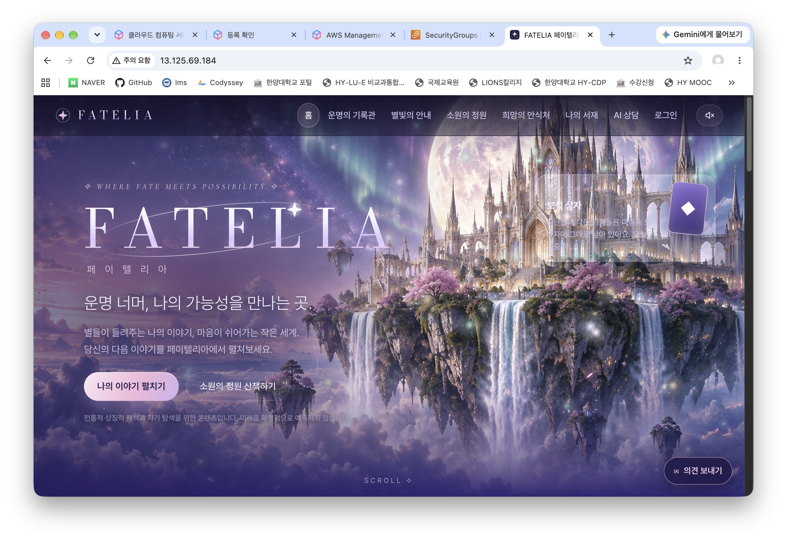

# B3-1 · FATELIA를 AWS에 올려 누구나 쓰게 하기

직접 기획·개발한 판타지 운세·자기탐색 웹서비스 **FATELIA**를 AWS 서울 리전에 배포했다.
VPC로 격리된 네트워크 안의 퍼블릭 서브넷에 EC2 1대를 두고, nginx가 80 포트로 요청을 받아 내부 전용(127.0.0.1:3000) FATELIA 앱으로 넘긴다.

## 외부 접속 검증

| 항목 | 값 |
|---|---|
| **선택한 방식** | **(A) 브라우저에서 `http://13.125.69.184` 접속** |
| 접속 주소 | `http://13.125.69.184` ← 제출 시점의 실제 IP로 교체 |
| 보조 확인 | `GET http://13.125.69.184/health` → `200 OK` / `OK` (nginx 고정 응답) |
| 증빙 | `docs/screenshots/external-browser.png`, `docs/screenshots/ts1-after-200.png` |

> 동료평가 기간에는 서버를 운영해 위 주소로 실시간 접속을 확인할 수 있다. 평가 종료 후 `docs/cleanup-checklist.md` 순서대로 리소스를 정리하며, 이후에는 스크린샷이 접속 증빙이 된다.



## 아키텍처


| 구성 요소 | 설정 | 역할 |
|---|---|---|
| VPC `b3-1-vpc` | `10.0.0.0/16`, ap-northeast-2 | 다른 네트워크와 격리된 나만의 사설 네트워크 |
| Public Subnet | `10.0.1.0/24`, ap-northeast-2a, 퍼블릭 IP 자동 할당 | 인터넷과 직접 통신하는 구역 |
| Internet Gateway | VPC에 Attach | VPC ↔ 인터넷 출입구. 퍼블릭 IP ↔ 프라이빗 IP 변환 |
| Route Table | `10.0.0.0/16 → local`, **`0.0.0.0/0 → IGW`**, Public Subnet에 연결 | "VPC 밖으로 가는 트래픽은 IGW로" — 이 경로가 있어야 퍼블릭 서브넷 |
| Security Group | IN 80 ← `0.0.0.0/0`, IN 22 ← 내 IP/32, OUT 전체 | 인스턴스 단위 방화벽(상태 저장형) |
| EC2 | t3.micro, Ubuntu 24.04 LTS, EBS gp3 8GiB | nginx + FATELIA(Node.js) |
| IAM `b3-1-operator` | `iam/b3-1-least-privilege-policy.json` | 이 실습에 필요한 EC2·VPC·SG 작업만 허용 |

### 외부 요청이 FATELIA까지 도달하는 흐름
1. 브라우저 → `http://13.125.69.184:80`
2. **Internet Gateway**가 퍼블릭 IP를 인스턴스의 프라이빗 IP(10.0.1.x)로 변환해 VPC 안으로 전달
3. **Route Table**의 `local` 경로로 서브넷 안 인스턴스에 도달 (응답은 `0.0.0.0/0 → IGW` 경로로 나감)
4. **Security Group**이 80/tcp 허용 규칙을 확인하고 통과 (응답은 상태 저장으로 자동 허용)
5. **nginx(:80)** 가 `/health`는 직접 `OK` 응답, 나머지는 `127.0.0.1:3000` **FATELIA**로 프록시

세 조건 중 하나라도 빠지면 외부 접속 불가: ① 라우팅(`0.0.0.0/0 → IGW`) ② 퍼블릭 IP ③ SG 80 허용.

## Security Group vs IAM

| | Security Group | IAM |
|---|---|---|
| 무엇을 막나 | **네트워크 트래픽** (어느 IP가 어느 포트로 들어오나) | **AWS API 작업** (누가 어떤 리소스를 만들고 지우나) |
| 적용 대상 | EC2 인스턴스의 네트워크 인터페이스 | 사용자·역할 |
| 이 미션의 최소권한 | 80만 전체 공개, 22는 내 IP만, Node 3000은 미공개 | EC2·VPC·SG 작업만, 서울 리전만, micro 인스턴스만, Admin·S3·RDS 없음 |

IAM 정책 설계 이유는 `docs/runbook.md` 0단계 표 참고.

> **계정 사용 원칙:** 루트 계정은 가입 직후 MFA 설정과 실습용 IAM 사용자 `b3-1-operator` 생성에만 사용했다. (새 계정에서는 첫 IAM 사용자를 루트로만 만들 수 있다.) 이후 모든 구축·검증·정리 작업은 `b3-1-operator`로 수행했다.

## 구성 및 실행 방법

| 파일 | 내용 |
|---|---|
| `docs/runbook.md` | 콘솔 구축 절차 전체 (IAM → VPC → SG → EC2 → 배포 → 검증) |
| `server/setup.sh` | EC2 초기 세팅: nginx·Node 설치, 1GiB 스왑, nginx 설정, 아웃바운드/헬스체크 확인 |
| `server/nginx/fatelia-proxy.conf` | 80 → 127.0.0.1:3000 리버스 프록시 + `/health` |
| `server/fatelia.service` | FATELIA를 전용 비로그인 사용자로 실행하는 systemd 서비스 |
| `server/deploy-from-mac.sh` | 로컬 FATELIA 코드를 rsync로 업로드 (`.env`·`node_modules` 제외) |
| `server/verify.sh` | 요구사항 자동 점검 (아웃바운드, nginx, localhost 200, /health) |
| `iam/b3-1-least-privilege-policy.json` | IAM 최소권한 정책 |

```bash
# EC2 안
sudo bash ~/server/setup.sh node
# Mac
bash server/deploy-from-mac.sh 13.125.69.184 ~/.ssh/b3-1-key.pem ~/경로/fatelia node
# EC2 안
bash ~/server/verify.sh
```

## 요구사항 체크

| 요구사항 | 결과 | 증빙 |
|---|---|---|
| VPC 1 / Public Subnet 1 / IGW 연결 | ✅ | `route-table.png`, `route-table-subnet.png` |
| Route Table `0.0.0.0/0 → IGW` | ✅ | `route-table.png` |
| 인스턴스 아웃바운드 (`curl https://example.com`) | ✅ | `verify.png` |
| EC2 1대, SSH 접속 | ✅ | `ec2-instance.png`, `ssh-login.png` |
| nginx 실행, `curl http://localhost` → 200 | ✅ | `verify.png`, `ts1-server-local-ok.png` |
| SG: 80 ← 0.0.0.0/0, 22 ← 내 IP, 전체 포트 개방 없음 | ✅ | `ts1-sg-after.png` |
| IAM 사용자 1, Admin 없음, S3/RDS 없음 | ✅ | `iam-user-policy.png`, `ts2-denied.png` |
| 외부 접속 (A) | ✅ | `external-browser.png`, `ts1-after-200.png` |
| 트러블슈팅 보고서 | ✅ | `docs/troubleshooting.md` (사례 4건) |
| 리소스 정리 | ☐ | `docs/cleanup-checklist.md` |

## 확장·비용 대응

현재는 `t3.micro` 1대 + SQLite 구조라 서버 1대가 단일 장애점이고 수평 확장이 불가능하다. 병목 진단 지표(CPU·CPU 크레딧·메모리·5xx·응답 시간)와 진단 순서, ALB 도입 기준과 설계(2개 AZ, SG 체인, `/health` 헬스체크), 비용 감시(Budgets·Cost Explorer·`Project=b3-1` 비용 할당 태그)는 [`docs/scaling-and-cost.md`](docs/scaling-and-cost.md)에 정리했다. 프리 티어 범위를 지키기 위해 이번 미션에서는 구현하지 않았다.

## 제출물

- `docs/architecture.png` (원본 `docs/architecture.dot`)
- `docs/troubleshooting.md`
- `docs/cleanup-checklist.md`
- `README.md` (이 문서)
- docs/scaling-and-cost.md (확장·비용 대응 계획)

> FATELIA 앱 소스는 별도 비공개 저장소에 있으며, 이 저장소에는 인프라·배포 설정과 증빙만 담았다. API 키 등 비밀값은 서버의 `/opt/fatelia/.env`에만 두고 어떤 저장소에도 커밋하지 않았다.
