# B3-1 · FATELIA를 AWS에 올려 누구나 쓰게 하기

제가 직접 기획하고 개발한 운세·자기탐색 웹서비스 **FATELIA**를 AWS 서울 리전에 배포했습니다.
VPC로 격리된 네트워크를 직접 만들고, 그 안의 퍼블릭 서브넷에 EC2 서버 한 대를 두었습니다. 서버에서는 nginx가 80번 포트로 요청을 받아, 서버 내부에서만 열려 있는 FATELIA 앱으로 전달합니다.

> **현재 상태:** 실습을 마친 뒤 과금이 생기지 않도록 만든 리소스를 모두 정리했습니다(2026-11-22). 그래서 아래 주소는 지금은 접속되지 않고, 구축하고 동작을 확인한 과정은 이 문서의 스크린샷으로 남겨 두었습니다.

| 구분 | 내용 |
|---|---|
| 외부 접속 확인 방식 | 브라우저로 `http://13.125.69.184` 접속 (보조로 `/health` 확인) |
| 리전 · 서버 | 서울(`ap-northeast-2`) · `t3.micro`, Ubuntu 24.04 LTS, 디스크 8GiB |
| 작업 계정 | IAM 사용자 `b3-1-operator` (최소 권한 정책 `B3-1-LeastPrivilege`) |

## 전체 구조

이 그림은 인터넷에서 들어온 요청이 FATELIA까지 가는 길을 보여 줍니다. 구성 요소는 아래와 같습니다.

| 구성 요소 | 설정 | 하는 일 |
|---|---|---|
| VPC `b3-1-vpc` | `10.0.0.0/16` | 다른 사용자와 분리된 저만의 네트워크입니다 |
| 퍼블릭 서브넷 `b3-1-public-subnet` | `10.0.1.0/24`, 가용 영역 `ap-northeast-2a`, 퍼블릭 IP 자동 할당 | 인터넷과 직접 통신하는 구역입니다 |
| 인터넷 게이트웨이 `b3-1-igw` | VPC에 연결 | VPC와 인터넷 사이의 출입구입니다 |
| 라우팅 테이블 `b3-1-public-rt` | VPC 내부는 `local`, 그 밖의 모든 주소(`0.0.0.0/0`)는 인터넷 게이트웨이로 | 트래픽을 어디로 보낼지 정하는 규칙표입니다 |
| 보안 그룹 `b3-1-web-sg` | 80번은 모두에게, 22번은 제 IP에만 | 서버 앞의 방화벽입니다 |
| EC2 `b3-1-web` | `t3.micro`, nginx와 FATELIA 실행 | 실제 웹 서비스를 돌리는 서버입니다 |
| IAM 사용자 `b3-1-operator` | [`iam/b3-1-least-privilege-policy.json`](iam/b3-1-least-privilege-policy.json) | 이번 실습에 필요한 작업만 할 수 있는 계정입니다 |

---

## 구축 결과

### 네트워크

VPC를 `10.0.0.0/16` 대역으로 만들고, 그 안에 퍼블릭 서브넷 `10.0.1.0/24`를 만들었습니다. 인터넷 게이트웨이를 VPC에 연결한 뒤, 서브넷에 연결된 라우팅 테이블에 "VPC 밖으로 가는 모든 트래픽은 인터넷 게이트웨이로 보낸다"는 경로(`0.0.0.0/0`)를 추가했습니다. 아래 화면에서 VPC 내부용 `local` 경로와 인터넷 게이트웨이로 가는 경로, 이렇게 두 줄을 확인할 수 있습니다.

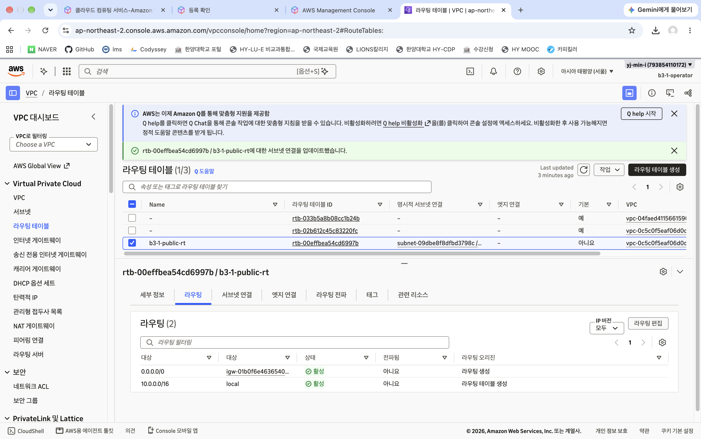

VPC · 서브넷 · 인터넷 게이트웨이 · 서브넷 연결 화면 보기

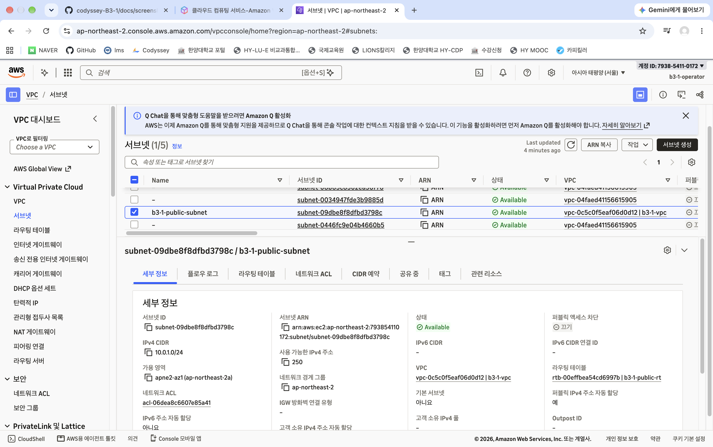
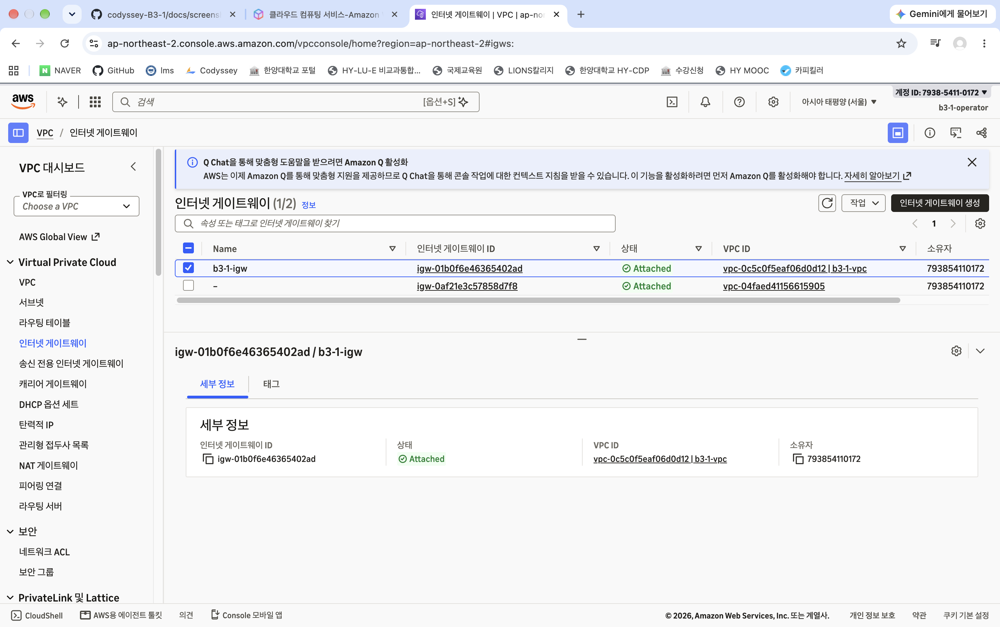

### 서버와 웹 서버

퍼블릭 서브넷에 EC2 인스턴스 `b3-1-web`을 만들고, 키 파일로 SSH 접속했습니다. 서버에는 nginx와 FATELIA를 설치해 실행했습니다. 직접 만든 점검 스크립트 `verify.sh`를 실행하면 다섯 가지를 한 번에 확인합니다. 서버에서 인터넷으로 나가는지, nginx와 FATELIA가 실행 중인지, 서버 안에서 접속했을 때 200이 나오는지, `/health`가 정상인지입니다. 아래 화면처럼 모두 통과했습니다.

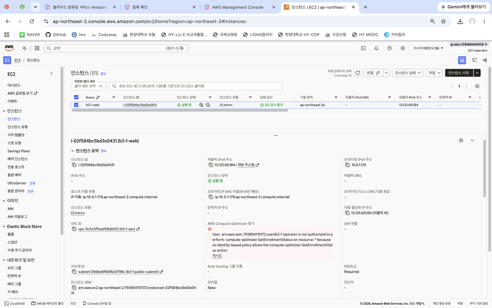
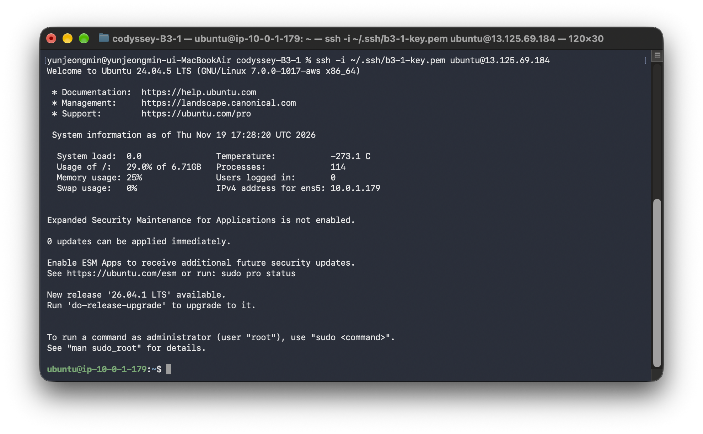

서버 안에서 접속 확인한 화면 보기

### 보안 그룹

보안 그룹의 인바운드 규칙은 두 줄뿐입니다. 웹사이트용 80번은 누구나 들어올 수 있게 열었고, 서버 관리용 22번은 제 IP 주소 하나에서만 들어올 수 있게 했습니다. FATELIA 앱이 쓰는 3000번 포트는 외부에 열지 않았고, 모든 포트를 여는 규칙도 만들지 않았습니다.

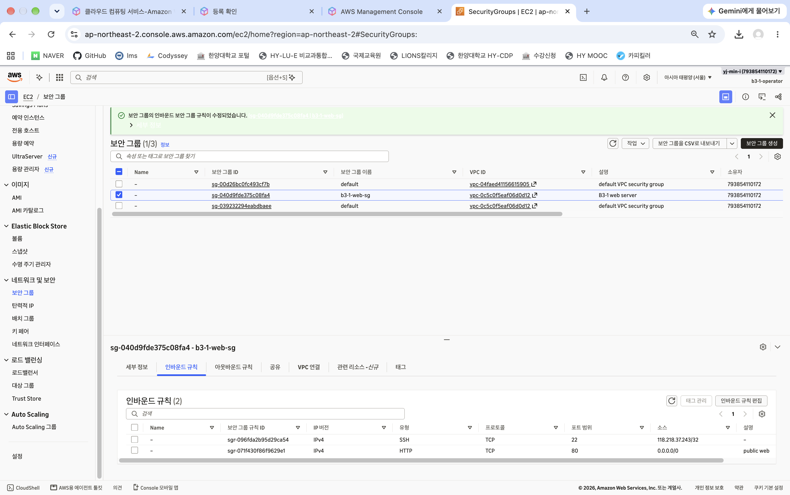

### 외부 접속 확인

외부 접속은 브라우저로 확인했습니다. 다른 컴퓨터의 브라우저 주소창에 `http://13.125.69.184`를 입력하면 FATELIA 첫 화면이 정상적으로 열립니다(맨 위 화면). 보조로, 제 Mac에서 `/health` 주소를 요청했을 때 `200 OK`와 `OK` 응답이 오는 것도 확인했습니다.

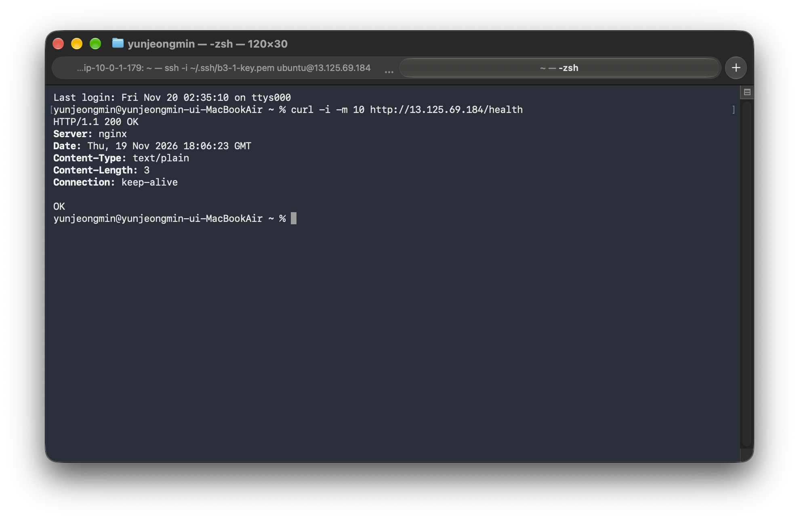

### 리소스 정리

실습을 마친 뒤 [`docs/cleanup-checklist.md`](docs/cleanup-checklist.md)의 순서대로 리소스를 정리했습니다. 먼저 EC2를 종료했고, 디스크(EBS)와 고정 IP(Elastic IP)가 남지 않았는지 확인했습니다. 그다음 키 페어와 보안 그룹을 지우고, 인터넷 게이트웨이를 VPC에서 분리해 삭제했습니다. 마지막으로 서브넷, 라우팅 테이블, VPC를 차례로 삭제했습니다.

| 리소스 | 정리 결과 | 증빙 |
|---|---|---|
| EC2 `b3-1-web` | 종료됨 | `cleanup-ec2.png` |
| EBS 볼륨 | 0개 (EC2를 종료할 때 함께 삭제됨) | `cleanup-ebs.png` |
| Elastic IP | 0개 (처음부터 만들지 않음) | `cleanup-eip.png` |
| 인터넷 게이트웨이 `b3-1-igw` | 분리한 뒤 삭제 | `cleanup-igw.png` |
| VPC `b3-1-vpc` | 삭제, 기본 VPC만 남음 | `cleanup-vpc.png` |

정리 결과 화면 보기

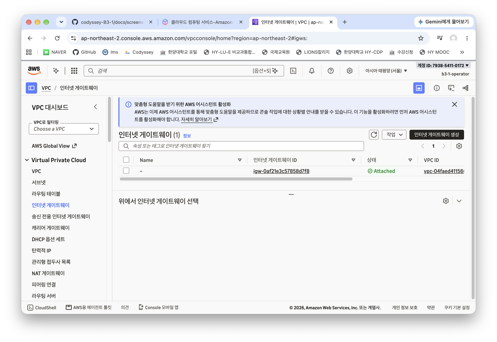

---

## 설계 설명

### 요청이 FATELIA까지 가는 길

위의 구조 그림을 따라가면 요청은 다섯 단계를 거칩니다.

1. 사용자의 브라우저가 `13.125.69.184`의 80번 포트로 요청을 보냅니다.
2. 인터넷 게이트웨이가 이 공인 주소를 서버의 내부 주소(`10.0.1.179`)로 바꿔 VPC 안으로 들여보냅니다.
3. 라우팅 테이블의 규칙에 따라 요청이 퍼블릭 서브넷에 있는 서버에 도착합니다. 서버의 응답은 반대로 인터넷 게이트웨이를 거쳐 밖으로 나갑니다.
4. 보안 그룹이 80번 포트가 허용돼 있는지 확인하고 통과시킵니다.
5. 서버의 nginx가 요청을 받아 FATELIA 앱으로 넘겨 줍니다.

이 과정에서 세 가지 중 하나라도 빠지면 밖에서 접속할 수 없습니다. 첫째, 라우팅 테이블에 인터넷 게이트웨이로 가는 경로가 있어야 합니다. 둘째, 서버에 공인 IP가 있어야 합니다. 셋째, 보안 그룹에서 80번이 열려 있어야 합니다. 실제로 보안 그룹에서 80번을 빼고 접속해 보니 응답 없이 시간 초과가 났고, 이 과정은 [트러블슈팅 보고서의 사례 1](docs/troubleshooting.md)에 기록했습니다.

### 보안 그룹을 이렇게 정한 이유

포트를 열 때의 기준은 "누가, 무엇을 하려고 들어와야 하는가"였습니다.

| 포트 | 열었는지 | 누구에게 | 이유 |
|---|---|---|---|
| 80 (HTTP) | 열었음 | 모든 사람 | 누구나 웹사이트를 써야 하기 때문입니다 |
| 22 (SSH) | 열었음 | 제 IP만 | 서버 관리는 저만 하기 때문입니다 |
| 3000 (FATELIA 앱) | 열지 않음 | — | nginx가 서버 안에서만 접근하면 되기 때문입니다 |
| 443 (HTTPS) | 열지 않음 | — | 이번에는 인증서를 적용하지 않았기 때문입니다 |
| 모든 포트 | 열지 않음 | — | 공격받을 수 있는 입구만 늘어나기 때문입니다 |

나가는 트래픽(아웃바운드)은 기본 설정인 "전체 허용"을 그대로 두었습니다. 서버에서 프로그램을 설치하고 외부 API를 호출하려면 인터넷으로 나갈 수 있어야 했기 때문입니다.

### 외부 접속을 브라우저로 확인한 이유와 구성

FATELIA는 실제로 화면이 있는 웹서비스라서, "누구나 쓸 수 있다"는 것을 보여 주기에는 브라우저 접속이 가장 직관적이라고 판단했습니다.

이를 위해 서버에 nginx를 80번 포트로 띄우고, 들어온 요청을 서버 내부의 FATELIA 앱(`127.0.0.1:3000`)으로 넘기도록 설정했습니다([`server/nginx/fatelia-proxy.conf`](server/nginx/fatelia-proxy.conf)). FATELIA는 시스템 서비스로 등록해서 서버가 재시작돼도 자동으로 실행되게 했습니다([`server/fatelia.service`](server/fatelia.service)).

`/health` 주소도 함께 만들어 두었습니다. 이 주소는 nginx가 직접 `OK`라고 답하기 때문에, 문제를 확인할 때 웹 서버가 살아 있는지 빠르게 볼 수 있습니다. 다만 이 응답은 nginx가 살아 있다는 것만 알려 주고, FATELIA 앱이나 데이터베이스까지 정상이라는 뜻은 아니라는 한계가 있습니다.

### 리소스를 추적하고 정리한 기준

리소스를 빠짐없이 정리하려고 세 가지 기준을 썼습니다.

- **이름 규칙:** 만든 리소스의 이름을 모두 `b3-1-`로 시작하게 했습니다. 예를 들어 `b3-1-vpc`, `b3-1-igw`, `b3-1-web`처럼 지어서 목록에서 한눈에 찾을 수 있습니다.
- **태그:** EC2, VPC, 서브넷, 인터넷 게이트웨이, 보안 그룹에 `Project = b3-1` 태그를 달았습니다. 이 태그로 이 프로젝트의 리소스만 골라 볼 수 있고, 비용도 따로 모아 볼 수 있습니다.
- **체크리스트:** 요금이 생길 수 있는 리소스를 목록으로 관리하고, 서로 연결된 순서대로 지우면서 결과 화면을 남겼습니다.

그리고 Elastic IP, NAT 게이트웨이, 로드밸런서, RDS처럼 켜 두기만 해도 요금이 나오는 리소스는 아예 만들지 않았습니다. 실습 계정의 권한에도 이것들을 만들 권한을 넣지 않았습니다.

태그 화면 보기

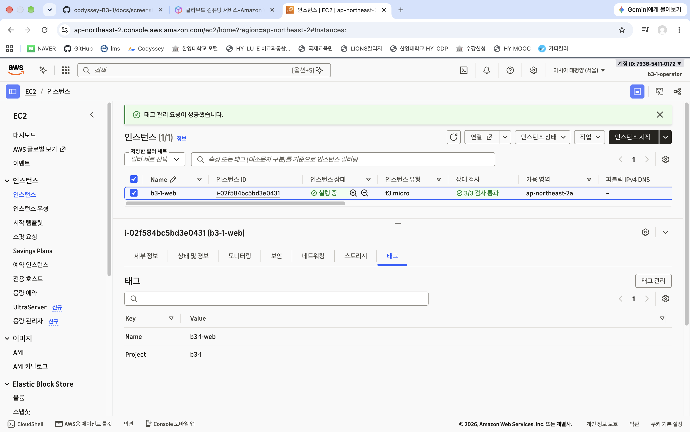

---

## 원리 정리

### 인터넷 게이트웨이로 가는 기본 경로가 필요한 이유

라우팅 테이블에는 처음에 VPC 내부로 가는 `local` 경로 하나만 있습니다. 그래서 VPC 밖의 주소로 가는 길을 모릅니다. 여기에 "그 밖의 모든 주소(`0.0.0.0/0`)는 인터넷 게이트웨이로 보낸다"는 경로를 추가해야 서버가 인터넷으로 나갈 수 있습니다. 밖에서 들어온 요청에 대한 응답이 다시 나가는 것도 이 경로 덕분입니다.

그래서 어떤 서브넷이 퍼블릭 서브넷인지는 이름이 아니라, 이 경로가 있는 라우팅 테이블에 연결돼 있는지로 정해집니다. 서버에서 `example.com`에 접속해 200 응답을 받은 것(`verify.png`)으로 이 경로가 동작하는 것을 확인했습니다.

### 보안 그룹과 IAM의 차이, 그리고 최소 권한

보안 그룹과 IAM은 둘 다 무언가를 막지만, 막는 대상이 다릅니다.

| | 보안 그룹 | IAM |
|---|---|---|
| 막는 것 | 서버로 들어오는 **네트워크 트래픽**입니다 | AWS에서 **어떤 작업을 할 수 있는지**입니다 |
| 적용 대상 | EC2 인스턴스 | 사용자와 역할 |
| 이번 설정 | 80번은 모두에게, 22번은 제 IP에만 열었습니다 | `b3-1-operator`는 서울 리전에서 EC2, VPC, 보안 그룹 작업만 할 수 있습니다 |

쉽게 말하면 보안 그룹은 건물 출입문의 방문자 명단이고, IAM은 직원 출입증에 찍힌 층별 권한입니다.

최소 권한이 필요한 이유는 사고가 나도 피해를 작게 만들기 위해서입니다. 이 계정의 비밀번호가 유출되더라도 다른 서비스를 건드리거나 비싼 서버를 만들 수 없고, 제 실수도 같은 범위 안에서 막힙니다. 실제로 이 계정으로 더 큰 서버(`t3.small`)를 만들려고 하니, 정책에 넣어 둔 거부 규칙 때문에 막혔습니다.

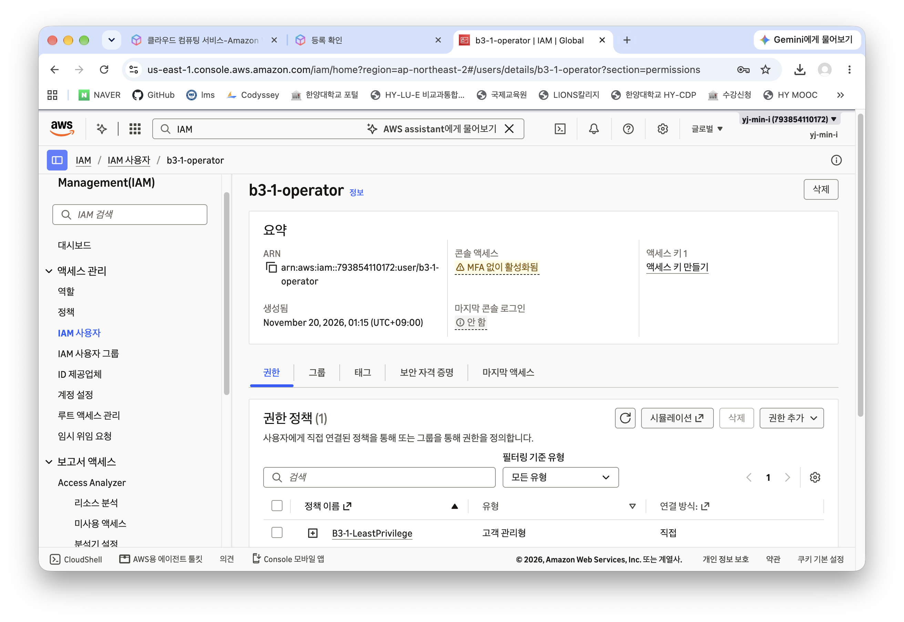

권한이 막히는 방식은 두 가지입니다. 하나는 정책에 "이건 하지 마"라는 거부 규칙을 일부러 넣어서 막는 **명시적 거부**이고, 위의 `t3.small` 사례가 여기에 해당합니다. 다른 하나는 허용한 적이 없어서 막히는 **묵시적 거부**입니다. 저는 이 계정에 IAM 조회 권한도 주지 않았기 때문에, IAM 화면을 열면 아래처럼 묵시적 거부가 나타납니다. 정책 원문은 [`iam/b3-1-least-privilege-policy.json`](iam/b3-1-least-privilege-policy.json)에 있습니다.

묵시적 거부 화면 보기

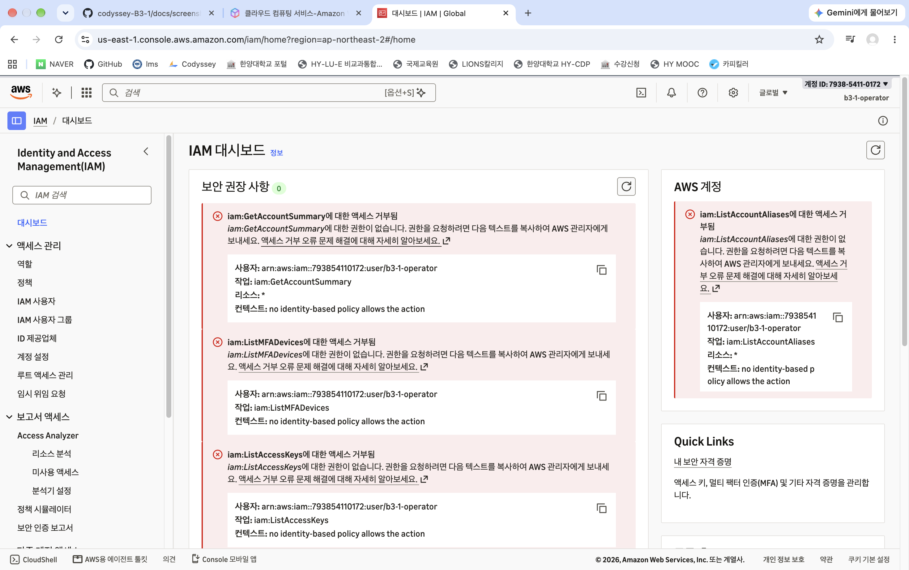

> **계정 사용 원칙:** 루트 계정은 가입 직후 보안 설정(MFA)과 실습용 IAM 사용자를 만드는 데에만 사용했습니다. 새 계정에서는 첫 IAM 사용자를 루트 계정으로만 만들 수 있기 때문입니다. 그 뒤의 모든 구축, 확인, 정리 작업은 `b3-1-operator`로 했습니다.

### SSH나 데이터베이스 포트를 모두에게 열면 안 되는 이유

인터넷에는 열린 포트를 자동으로 찾아다니는 프로그램이 항상 돌고 있습니다. SSH(22번)나 데이터베이스 포트를 모두에게 열어 두면 이런 프로그램이 계속 로그인을 시도하고, 한 번이라도 뚫리면 서버와 데이터 전체를 잃게 됩니다.

그래서 저는 22번을 제 IP 주소 하나에서만 들어올 수 있게 했고, 비밀번호 대신 키 파일로만 로그인하게 했습니다. FATELIA는 데이터베이스를 파일 형태(SQLite)로 쓰기 때문에 데이터베이스용 포트를 열 필요가 없었고, 앱 포트 3000번도 nginx 뒤에 숨겼습니다.

더 안전하게 하려면 SSH 포트를 아예 닫고 AWS의 Session Manager나 VPN을 통해 접속하는 방법이 있습니다. 데이터베이스를 따로 둔다면 외부와 연결되지 않은 프라이빗 서브넷에 두고, 앱 서버에서만 접근할 수 있게 하는 것이 좋습니다.

### 문제를 해결할 때 가설과 검증을 지킨 이유

문제가 생겼을 때 감으로 이것저것 바꾸면 우연히 해결돼도 원인을 모르고, 필요 없는 설정을 남기기 쉽습니다. 예를 들어 접속이 안 된다고 모든 포트를 열어 버리는 식입니다. 그래서 원인이 될 수 있는 후보를 먼저 적고, 화면과 명령 결과를 근거로 하나씩 지워 가며 꼭 필요한 조치 하나만 했습니다. 실제로 겪은 네 가지 문제를 [`docs/troubleshooting.md`](docs/troubleshooting.md)에 증상, 가설, 검증, 조치, 결과, 재발 방지 순서로 기록했습니다.

| 사례 | 무슨 일이 있었나 | 무엇을 근거로 원인을 찾았나 | 어떻게 해결했나 |
|---|---|---|---|
| 1 | 밖에서 접속하면 시간 초과가 났습니다 | 연결 거부가 아니라 시간 초과였고, 서버 안에서는 정상이었고, SSH는 됐습니다. 그래서 보안 그룹으로 좁혔습니다 | 보안 그룹에 80번을 추가했습니다 |
| 2 | 더 큰 서버를 만들 수 없었습니다 | 오류 메시지에 거부한 정책 이름이 직접 나와 있었습니다 | 권한을 늘리지 않고 허용된 크기의 서버를 썼습니다 |
| 3 | IAM 계정 로그인이 실패했습니다 | 계정 ID 칸에 로그인 주소 전체가 들어가 있었습니다 | 12자리 숫자만 입력했습니다 |
| 4 | 설치 직후 `/health`가 404였습니다 | 실제로 적용된 nginx 설정을 확인해 보니 정상이었습니다 | 다시 요청하니 정상이었고, 설치 스크립트를 더 안전하게 고쳤습니다 |

사례 1 · 3 화면 보기

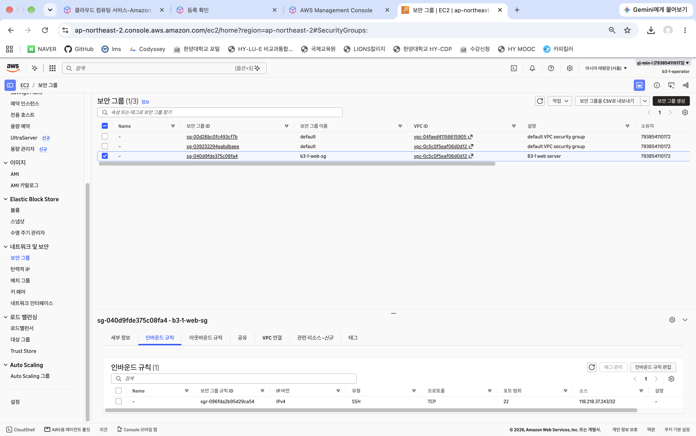

---

## 운영 시나리오

### 밖에서 접속이 안 될 때 확인하는 순서

요청이 지나가는 길을 따라 바깥쪽부터 확인합니다.

| 순서 | 확인할 것 | 확인 방법 |
|---|---|---|
| 1. 라우팅 | 라우팅 테이블에 인터넷 게이트웨이로 가는 경로가 있는지, 서브넷이 연결돼 있는지, 인터넷 게이트웨이가 VPC에 붙어 있는지 | VPC 콘솔에서 확인하고, 서버에서 `curl https://example.com`이 되는지 봅니다 |
| 2. 보안 그룹 | 요청하는 포트가 인바운드 규칙에 있는지 | EC2 콘솔의 보안 그룹 화면에서 확인합니다 |
| 3. 공인 IP·도메인 | 서버에 공인 IP가 있고, 내가 접속하는 주소와 같은지 | 서버를 껐다 켜면 IP가 바뀔 수 있으니 EC2 세부 정보에서 확인합니다 |
| 4. 서버 프로그램·로그 | nginx와 FATELIA가 실행 중이고 포트에서 기다리고 있는지 | `systemctl status`, `ss -tlnp`, nginx 오류 로그, FATELIA 로그를 봅니다 |

증상으로 먼저 범위를 좁힐 수도 있습니다. 응답 없이 시간 초과가 나면 라우팅이나 보안 그룹 문제일 가능성이 큽니다. "연결 거부"가 나오면 서버까지는 갔지만 프로그램이 꺼져 있는 것입니다. "502 오류"가 나오면 nginx는 살아 있지만 그 뒤의 앱이 멈춘 것입니다.

### 권한이 부족해 작업이 실패했을 때

권한을 한 번에 크게 늘리지 않고, 필요한 만큼만 찾아서 추가합니다.

1. 먼저 오류 메시지를 읽습니다. 어떤 작업이 어떤 리소스에서 막혔는지, 그리고 명시적 거부인지 묵시적 거부인지 확인합니다. 메시지가 암호처럼 인코딩돼 있으면 해독 명령으로 풀어 봅니다. 이 해독 권한은 미리 정책에 넣어 두었습니다.
2. 명시적 거부라면 권한을 더해도 풀리지 않습니다. 거부 규칙이 항상 우선하기 때문입니다. 일부러 막아 둔 것이라면 요청 자체를 바꿉니다. 제 사례 2가 그렇습니다.
3. 묵시적 거부라면 막힌 작업 하나만, 리전과 대상도 좁혀서 추가합니다. 예를 들어 모니터링 화면이 필요하면 모니터링 데이터를 읽는 권한만 추가합니다.
4. 다시 실행해 확인하고, 왜 추가했는지 기록합니다.

이 과정에는 IAM 정책 시뮬레이터, CloudTrail 기록, IAM Access Analyzer 같은 도구를 쓸 수 있습니다. 관리자 권한을 통째로 주는 방법은 쓰지 않습니다.

### 사용자가 늘어 서버를 두 대로 늘려야 한다면

지금 구조에는 병목이 세 가지 있습니다. 첫째, 작은 서버(`t3.micro`) 한 대가 감당할 수 있는 양에 한계가 있습니다. 둘째, 서버도 한 대, 가용 영역도 하나라서 그곳에 문제가 생기면 서비스 전체가 멈춥니다. 셋째, FATELIA의 데이터베이스가 서버 안의 파일(SQLite)이라 서버를 두 대로 늘리면 데이터가 둘로 나뉩니다. 그래서 지금은 서버만 하나 더 띄우는 방식으로는 늘릴 수 없습니다.

늘리려면 다음 순서로 구성을 바꿉니다. 먼저 데이터베이스를 RDS 같은 별도 서비스로 옮깁니다. 그다음 다른 가용 영역에 서브넷을 하나 더 만들고, 두 서브넷에 걸쳐 로드밸런서(ALB)를 둡니다. 로드밸런서가 두 서버에 요청을 나눠 보내고, `/health`로 서버 상태를 확인해 문제 있는 서버는 제외합니다. 이때 서버의 보안 그룹은 로드밸런서에서 오는 요청만 받게 바꿔서, 서버에 직접 접속하는 길을 막습니다.

병목을 찾는 지표, 로드밸런서를 도입하는 기준, 비용을 지켜보는 방법은 [`docs/scaling-and-cost.md`](docs/scaling-and-cost.md)에 정리했습니다. 이번에는 프리 티어 안에서 진행하기 위해 실제로 만들지는 않았습니다.

### 예상하지 못한 비용이 청구됐다면

켜 두기만 해도 요금이 나오는 것부터 의심합니다. 순서는 다음과 같습니다.

1. 실행 중인 EC2. 다른 리전에 실수로 만든 것도 포함합니다.
2. 서버에 연결하지 않은 채 남은 고정 IP(Elastic IP)와 공인 IP
3. 서버 없이 남은 디스크(EBS)와 스냅샷
4. NAT 게이트웨이, 로드밸런서, RDS
5. 인터넷으로 나간 데이터 양

원인은 청구서를 서비스별·리전별로 나눠 보거나, Cost Explorer에서 서비스·리전·사용 유형별로 분석해서 찾습니다. `Project = b3-1` 태그로 이 프로젝트 리소스만 골라 보고, EC2의 "글로벌 보기"로 모든 리전을 한 번에 확인합니다. 원인을 찾으면 연결된 순서대로 지우고, 다음 날 비용이 더 늘지 않는지 확인합니다. 다시 생기지 않도록 예산 알림(AWS Budgets)도 설정합니다.

참고로 이 계정은 무료 플랜이라 사용량은 무료 크레딧에서 빠지고, 유료로 전환하기 전에는 카드로 청구되지 않습니다. 결제 화면은 루트 계정으로만 볼 수 있어서, 루트 사용을 최소화한다는 원칙에 따라 이번에는 직접 확인하지 않았습니다.

---

## 파일 구성

| 파일 | 내용 |
|---|---|
| [`docs/architecture.png`](docs/architecture.png) | 구조 그림 (원본 `docs/architecture.dot`) |
| [`docs/troubleshooting.md`](docs/troubleshooting.md) | 트러블슈팅 보고서 (실제 사례 4건) |
| [`docs/cleanup-checklist.md`](docs/cleanup-checklist.md) | 리소스 정리 체크리스트 |
| [`docs/scaling-and-cost.md`](docs/scaling-and-cost.md) | 확장과 비용 관리 계획 |
| [`docs/runbook.md`](docs/runbook.md) | 콘솔에서 구축한 전체 절차 |
| [`iam/b3-1-least-privilege-policy.json`](iam/b3-1-least-privilege-policy.json) | IAM 최소 권한 정책 |
| `server/setup.sh` | 서버 초기 설정 스크립트 (nginx·Node 설치, nginx 설정, 확인) |
| `server/nginx/fatelia-proxy.conf` | 80번으로 받은 요청을 FATELIA로 넘기는 nginx 설정과 `/health` |
| `server/fatelia.service` | FATELIA를 전용 사용자로 자동 실행하는 서비스 설정 |
| `server/deploy-from-mac.sh` | Mac의 FATELIA 코드를 서버로 올리는 스크립트 (비밀값 제외) |
| `server/verify.sh` | 동작을 한 번에 점검하는 스크립트 |
| `docs/screenshots/` | 모든 증빙 스크린샷 |

> FATELIA 앱의 소스 코드는 별도의 비공개 저장소에 있고, 이 저장소에는 배포 설정과 증빙만 담았습니다. API 키 같은 비밀값은 어떤 저장소에도 올리지 않았습니다.
