# B3-1 · FATELIA를 AWS에 올려 누구나 쓰게 하기

직접 기획·개발한 판타지 운세·자기탐색 웹서비스 **FATELIA**를 AWS 서울 리전(`ap-northeast-2`)에 배포했다.
VPC로 격리된 네트워크 안의 퍼블릭 서브넷에 EC2 1대를 두고, nginx가 80 포트로 요청을 받아 내부 전용(`127.0.0.1:3000`) FATELIA 앱으로 넘긴다.

> **현재 상태:** 미션 요구사항에 따라 실습 종료 후 리소스를 모두 정리했다(2026-11-22). 아래 주소는 현재 접속되지 않으며, 모든 구현은 이 문서의 스크린샷으로 증빙한다.

| 항목 | 값 |
|---|---|
| 외부 접속 검증 방식 | **(A) 브라우저에서 `http://13.125.69.184` 접속** |
| 보조 확인 | `GET http://13.125.69.184/health` → `200 OK` / `OK` |
| 리전 · 인스턴스 | 서울 `ap-northeast-2` · `t3.micro` (Ubuntu 24.04 LTS, EBS gp3 8GiB) |
| 작업 계정 | IAM 사용자 `b3-1-operator` (최소권한 정책 `B3-1-LeastPrivilege`) |

## 아키텍처

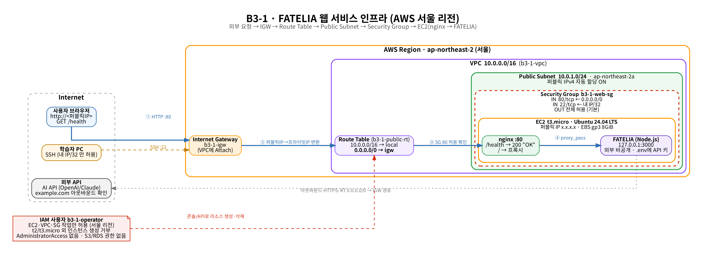

| 구성 요소 | 설정 | 역할 |
|---|---|---|
| VPC `b3-1-vpc` | `10.0.0.0/16` | 다른 네트워크와 격리된 나만의 사설 네트워크 |
| Public Subnet `b3-1-public-subnet` | `10.0.1.0/24`, `ap-northeast-2a`, 퍼블릭 IPv4 자동 할당 | 인터넷과 직접 통신하는 구역 |
| Internet Gateway `b3-1-igw` | VPC에 Attach | VPC ↔ 인터넷 출입구, 퍼블릭 IP ↔ 프라이빗 IP 변환 |
| Route Table `b3-1-public-rt` | `10.0.0.0/16 → local`, **`0.0.0.0/0 → IGW`**, 서브넷에 연결 | 이 경로가 있어야 퍼블릭 서브넷 |
| Security Group `b3-1-web-sg` | IN 80 ← `0.0.0.0/0`, IN 22 ← 내 IP `/32`, OUT 기본값 | 인스턴스 단위 방화벽(Stateful) |
| EC2 `b3-1-web` | `t3.micro`, nginx + FATELIA(Node.js) | 웹 서비스 |
| IAM `b3-1-operator` | [`iam/b3-1-least-privilege-policy.json`](iam/b3-1-least-privilege-policy.json) | 실습에 필요한 EC2·VPC·SG 작업만 허용 |

---

# 평가 항목별 구현 증빙

## 항목 1. 구성과 동작

### 1-1. VPC · Public Subnet · Internet Gateway · Route Table(0.0.0.0/0 → IGW)

VPC `10.0.0.0/16` 안에 퍼블릭 서브넷 `10.0.1.0/24`를 만들고, IGW를 VPC에 연결한 뒤 서브넷의 라우팅 테이블에 `0.0.0.0/0 → IGW` 경로를 추가했다.

VPC · 서브넷 · IGW · 서브넷 연결 화면 보기

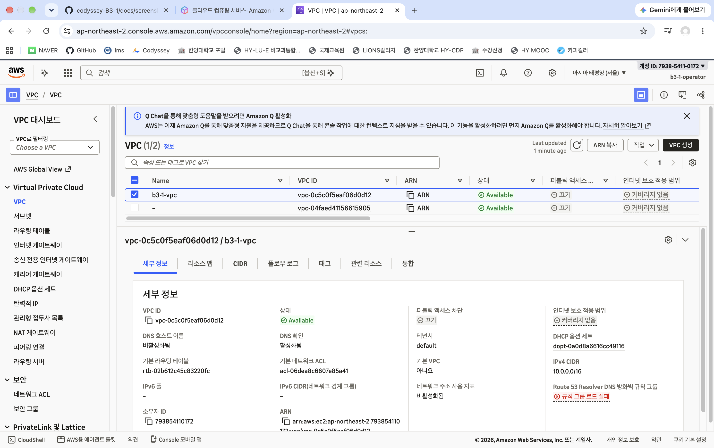

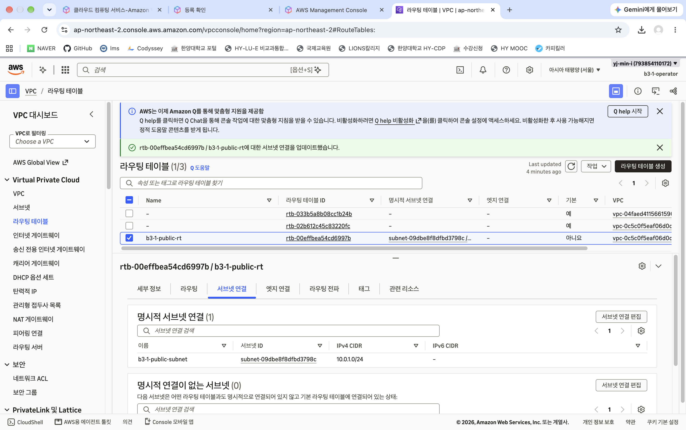

### 1-2. EC2에 SSH 접속 가능 · 웹 서버 실행 중

키 파일로 `ubuntu@13.125.69.184`에 SSH 접속했다. 점검 스크립트(`server/verify.sh`)에서 아웃바운드(`example.com` 200), nginx·FATELIA 실행, `curl http://localhost` 200, `/health` 200이 모두 PASS다.

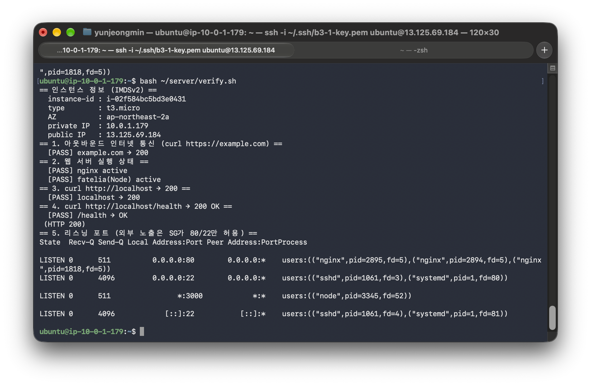

서버 안 curl localhost 200 · nginx 80 대기 화면 보기

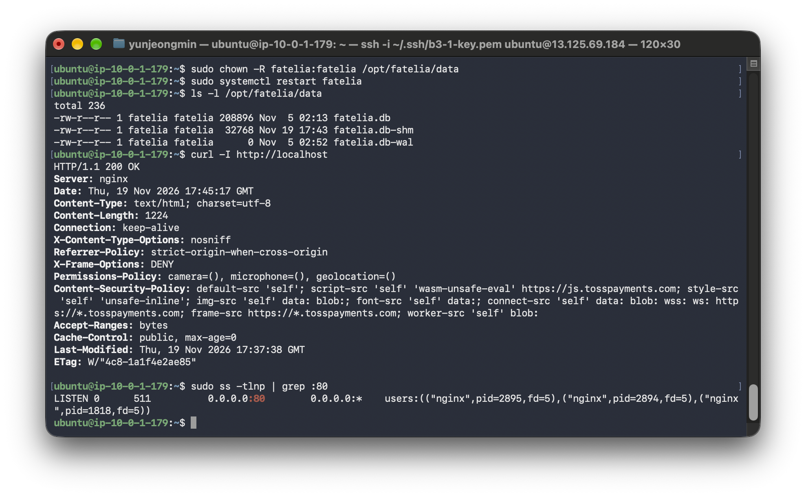

### 1-3. 보안 그룹: 필요 포트만, SSH(22)는 특정 IP로 제한

인바운드는 두 줄뿐이다. **80은 `0.0.0.0/0`**, **22는 내 IP `/32`**. Node 앱 포트 3000과 전체 포트(0-65535) 규칙은 만들지 않았다.

### 1-4. 외부 접속 검증 — (A) 브라우저

선택 방식은 **(A) 브라우저**다. 주소창에 `http://13.125.69.184`를 입력해 FATELIA 첫 화면이 정상 로딩되는 것을 확인했다(맨 위 이미지). 보조로 (B) `/health`도 외부에서 `200 OK` / `OK`를 확인했다.

### 1-5. 리소스 정리 완료 (EC2 · EBS · EIP · IGW · VPC)

[`docs/cleanup-checklist.md`](docs/cleanup-checklist.md) 순서(EC2 종료 → EBS·EIP 확인 → 키 페어·보안 그룹 → IGW 분리·삭제 → 서브넷·라우팅 테이블 → VPC)대로 정리했고, 각 단계의 결과 화면을 남겼다.

| 리소스 | 결과 | 증빙 |
|---|---|---|
| EC2 `b3-1-web` | 종료됨(Terminated) | `cleanup-ec2.png` |
| EBS 볼륨 | 0개 (종료 시 자동 삭제) | `cleanup-ebs.png` |
| Elastic IP | 0개 (처음부터 할당 안 함) | `cleanup-eip.png` |
| Internet Gateway `b3-1-igw` | 분리 후 삭제 | `cleanup-igw.png` |
| VPC `b3-1-vpc` | 삭제 (기본 VPC만 남음) | `cleanup-vpc.png` |

정리 결과 화면 보기

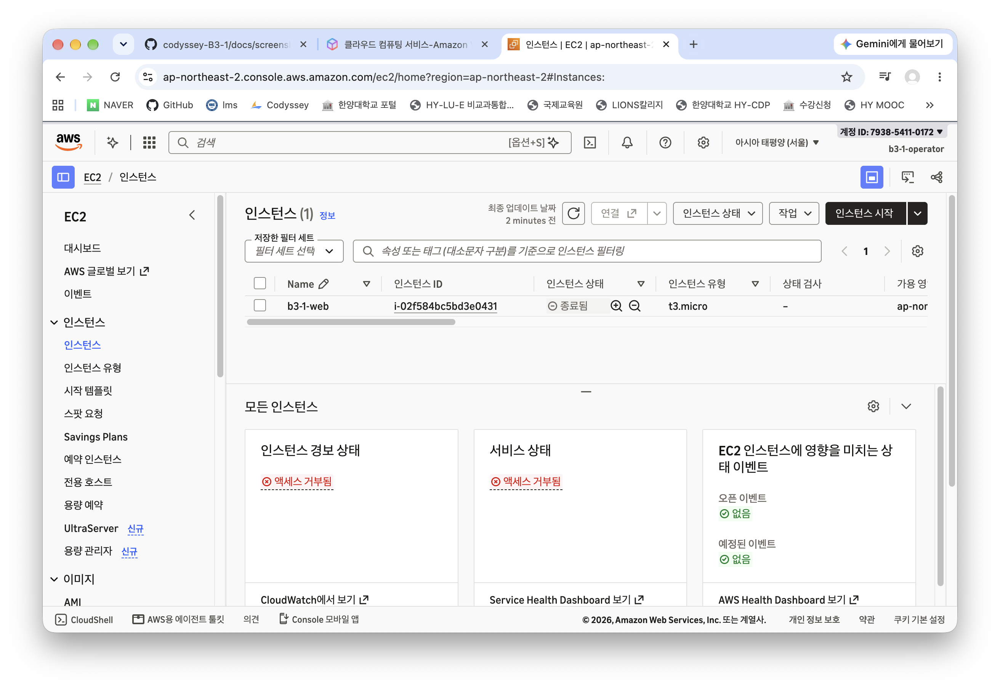
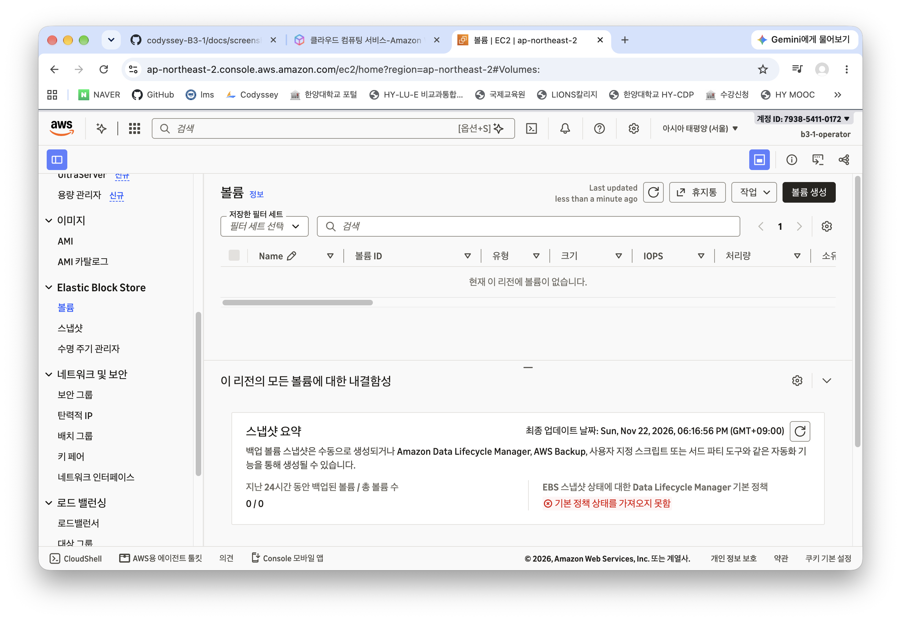
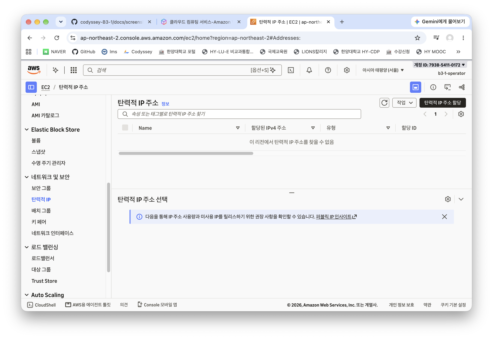

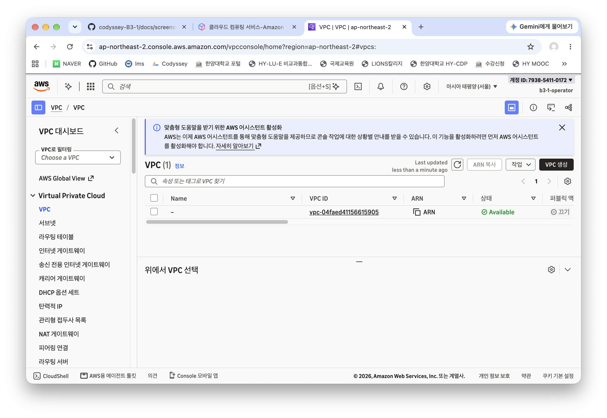

---

## 항목 2. 구성 설명

### 2-1. 외부 → IGW → Subnet → EC2 네트워크 흐름 (다이어그램 기준)

1. 브라우저 → `13.125.69.184:80`
2. **IGW**가 퍼블릭 IP를 EC2의 프라이빗 IP(`10.0.1.179`)로 바꿔 VPC 안으로 전달
3. **라우팅 테이블**의 `local` 경로로 퍼블릭 서브넷의 EC2에 도착 (응답은 `0.0.0.0/0 → IGW`로 나감)
4. **보안 그룹**이 80번 허용 규칙을 확인하고 통과
5. **nginx(:80)** 가 `/health`는 직접 `OK`, 나머지는 `127.0.0.1:3000`의 **FATELIA**로 전달

세 조건 중 하나라도 빠지면 외부 접속이 안 된다: ① 라우팅 `0.0.0.0/0 → IGW` ② 퍼블릭 IP ③ 보안 그룹 80 허용. 실제로 ③을 빼고 접속하면 타임아웃이 나는 것을 확인했다([트러블슈팅 사례 1](docs/troubleshooting.md)).

### 2-2. 보안 그룹 최소화 기준 (허용/미허용 포트)

기준은 **누가, 무엇을 위해 들어와야 하는가** 이다.

| 포트 | 허용 | 소스 | 이유 |
|---|---|---|---|
| 80 (HTTP) | 허용 | `0.0.0.0/0` | 누구나 웹사이트를 써야 함 |
| 22 (SSH) | 허용 | 내 IP `/32` | 관리자만 서버 관리 |
| 3000 (Node) | 미허용 | — | nginx가 서버 내부에서만 접근 |
| 443 (HTTPS) | 미허용 | — | 인증서 미적용(보너스 1 미수행) |
| 전체 포트 | 금지 | — | 공격 표면만 늘어남 |

아웃바운드는 기본값(전체 허용)이다. 패키지 설치(apt·npm)와 외부 API 호출에 필요했다.

### 2-3. 외부 접속 검증 방식 선택과 구성

- **선택: (A) 브라우저.** FATELIA는 실제 웹서비스라 "누구나 쓸 수 있다"는 미션 목표를 화면으로 가장 직관적으로 보여 준다.
- **구성:** nginx를 80번에 띄우고 `/`를 FATELIA(Node, `127.0.0.1:3000`)로 프록시했다([`server/nginx/fatelia-proxy.conf`](server/nginx/fatelia-proxy.conf)). FATELIA는 systemd 서비스로 등록해 재부팅 후에도 자동 실행되게 했다([`server/fatelia.service`](server/fatelia.service)).
- **(B)도 대비:** nginx에 `location = /health`를 두어 항상 `200 OK` / `OK`를 돌려주게 했고, 트러블슈팅 검증에도 썼다. 단 이 응답은 nginx가 살아 있는지만 보장하고 앱·DB 상태는 보장하지 않는다.

### 2-4. 리소스 추적·정리 기준

- **이름 규칙:** 모든 리소스에 `b3-1-` 접두사(`b3-1-vpc`, `b3-1-public-subnet`, `b3-1-igw`, `b3-1-public-rt`, `b3-1-web-sg`, `b3-1-web`, `b3-1-key`)
- **태그:** `Project = b3-1` (EC2·VPC·서브넷·IGW·보안 그룹)
- **체크리스트:** 과금 대상 리소스를 생성 시점부터 [`docs/cleanup-checklist.md`](docs/cleanup-checklist.md)로 추적하고, 의존 순서대로 정리하며 결과 화면을 남김
- **만들지 않은 것:** Elastic IP·NAT Gateway·ALB·RDS는 만들지 않았고, IAM 정책상 만들 권한도 없다

태그 화면 보기

---

## 항목 3. 원리 설명

### 3-1. 기본 경로(0.0.0.0/0 → IGW)가 필요한 이유

라우팅 테이블의 기본 경로는 `10.0.0.0/16 → local` 하나뿐이라 VPC 밖으로 가는 길을 모른다. `0.0.0.0/0`(그 밖의 모든 주소)을 IGW로 보내야 인터넷으로 나갈 수 있고, 들어온 요청의 **응답도 나갈 수 있다**. 그래서 서브넷이 "퍼블릭"인지는 이름이 아니라 이 경로가 있는 라우팅 테이블에 연결됐는지로 결정된다. 서버에서 `curl https://example.com`이 200인 것(`verify.png`)으로 확인했다.

### 3-2. Security Group vs IAM, 최소 권한이 필요한 이유

| | Security Group | IAM |
|---|---|---|
| 통제 대상 | **네트워크 트래픽** (어느 IP가 어느 포트로) | **AWS 작업** (누가 어떤 리소스를 만들고 지우나) |
| 붙는 곳 | EC2 인스턴스 | 사용자·역할 |
| 이 미션 | 80 전체, 22 내 IP, 3000 미공개 | `b3-1-operator`: 서울 리전 EC2·VPC·SG 작업만, `t2/t3.micro` 외 인스턴스 **명시적 거부**, Admin·S3·RDS 없음 |

최소 권한은 사고가 나도 **피해 범위를 작게** 하기 위해서다. 실제로 `t3.small`을 시작하면 정책의 명시적 거부(explicit deny)로 막힌다.

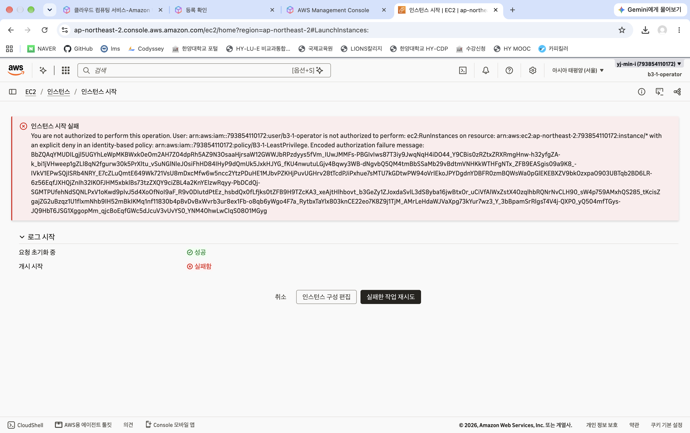

정책 원문은 [`iam/b3-1-least-privilege-policy.json`](iam/b3-1-least-privilege-policy.json)에 있다(`DenyNonFreeTierInstanceTypes` 문 참고). `b3-1-operator`에는 IAM 조회 권한도 주지 않았기 때문에, 이 사용자로 IAM 대시보드를 열면 **묵시적 거부**가 표시된다.

명시적 거부 vs 묵시적 거부 화면 보기

- **명시적 거부(explicit deny):** 정책의 Deny 문에 걸림 → `ts2-denied.png` (위 이미지)
- **묵시적 거부:** 허용한 정책이 없음 → 오류 문구 `no identity-based policy allows the action`

> **계정 사용 원칙:** 루트 계정은 가입 직후 MFA 설정과 실습용 IAM 사용자 `b3-1-operator` 생성에만 사용했다(새 계정에서는 첫 IAM 사용자를 루트로만 만들 수 있다). 이후 모든 구축·검증·정리 작업은 `b3-1-operator`로 수행했다.

### 3-3. SSH(22)·DB 포트를 0.0.0.0/0로 열면 안 되는 이유와 대안

- **이유:** 전 세계 자동 스캐너가 열린 22번·DB 포트에 계속 로그인을 시도한다. 뚫리면 서버와 데이터 전체가 넘어간다.
- **적용한 대안:** 22는 내 IP `/32`로만, 비밀번호 대신 키 파일(`.pem`, 권한 400)로만 로그인. DB(SQLite)는 파일이라 포트를 열지 않았고, 앱 포트 3000도 nginx 뒤에 숨겼다.
- **더 나은 대안:** IP가 바뀌는 환경이면 점검 때만 SG를 "내 IP"로 갱신하거나, 22를 닫고 AWS Systems Manager Session Manager·VPN·점프 호스트로 접속한다. DB는 프라이빗 서브넷에 두고 앱 서버의 보안 그룹에서만 접근을 허용한다.

### 3-4. 트러블슈팅: 가설 → 검증 순서를 지킨 이유와 근거 활용

감으로 설정을 바꾸면 원인을 모른 채 불필요한 구멍(예: 포트 전체 개방)을 남기기 쉽다. 후보를 적고 증거로 하나씩 지우면 필요한 조치 하나만 하게 된다. [`docs/troubleshooting.md`](docs/troubleshooting.md)에 실제로 겪은 4건을 증상 → 가설 → 검증 → 조치 → 결과 → 재발 방지로 기록했다.

| 사례 | 증상 | 근거 | 조치 |
|---|---|---|---|
| 1 | 외부 접속 타임아웃 | `curl` 타임아웃(≠ refused), 서버 안 `ss`로 nginx :80 대기, SSH는 됨 → SG로 좁힘 | SG에 HTTP 80 추가 |
| 2 | `t3.small` 시작 거부 | 오류 메시지의 `explicit deny … policy/B3-1-LeastPrivilege` | 권한을 늘리지 않고 `t3.micro` 사용 |
| 3 | IAM 로그인 실패 | Account ID 칸에 로그인 URL 전체 입력 | 12자리 ID만 입력 |
| 4 | 세팅 직후 `/health` 404 | `sites-enabled`, `nginx -T`로 실제 로드된 설정 확인 | 재요청 정상, 스크립트를 restart로 수정 |

사례 1 · 3 화면 보기

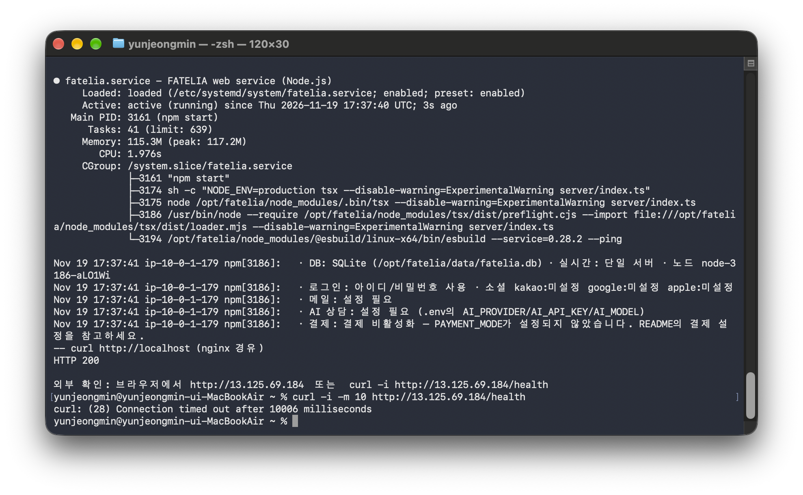

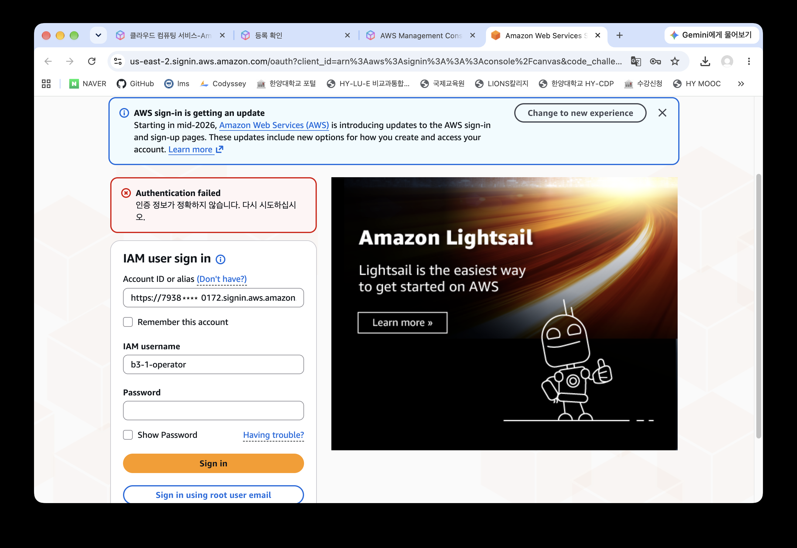

---

## 항목 4. 상황 대응

### 4-1. 외부 접속이 안 될 때 점검 순서

| 순서 | 확인할 것 | 방법 |
|---|---|---|
| 1. 라우팅 | `0.0.0.0/0 → igw`(활성), 서브넷 연결, IGW Attached | VPC 콘솔, 서버에서 `curl https://example.com` |
| 2. 보안 그룹 | 요청 포트가 인바운드에 있고 소스가 맞는지 | EC2 → 보안 그룹 → 인바운드 규칙 |
| 3. 퍼블릭 IP/DNS | 퍼블릭 IP가 있고 접속 주소와 같은지(중지·시작 시 변경) | EC2 세부 정보, `nslookup 도메인` |
| 4. 서버 프로세스/로그 | nginx·앱이 실행 중이고 포트에서 대기하는지 | `systemctl status nginx fatelia`, `ss -tlnp`, `curl -I localhost`, `/var/log/nginx/error.log`, `journalctl -u fatelia` |

증상으로 먼저 좁힌다: **타임아웃** → 라우팅·SG, **Connection refused** → 서버 프로세스, **502** → nginx 뒤의 앱.

### 4-2. IAM 권한 부족 시 최소 범위 찾기

1. 오류 메시지에서 막힌 **action·리소스**와 **명시적/묵시적 거부**를 확인한다. 인코딩된 메시지는 `aws sts decode-authorization-message`로 해독한다(이를 위해 정책에 `sts:DecodeAuthorizationMessage`를 넣어 둠).
2. **명시적 거부**면 권한을 더해도 풀리지 않는다(Deny 우선). 의도한 차단이면 요청을 바꾼다(사례 2).
3. **묵시적 거부**면 그 action 하나만 리전·리소스 조건을 좁혀 추가한다(예: 모니터링이 필요하면 `cloudwatch:GetMetricData`·`ListMetrics` 읽기만).
4. 다시 실행해 확인하고 추가 이유를 기록한다. 도구: IAM 정책 시뮬레이터, CloudTrail(AccessDenied 기록), IAM Access Analyzer(사용 기록 기반 정책 생성). AdministratorAccess는 쓰지 않는다.

### 4-3. 인스턴스를 2대로 늘린다면

- **병목:** `t3.micro` 1대의 처리 한계(메모리 1GiB, CPU 크레딧), 서버 1대·AZ 1개의 단일 장애점, **DB가 서버 안 SQLite 파일**이라 2대로 늘리면 데이터가 나뉨
- **추가할 것:** DB를 RDS 등 외부로 분리 → 다른 AZ(`2c`)에 서브넷 추가 → **ALB**를 두 서브넷에 두고 인스턴스 2대를 대상 그룹으로(헬스체크 `/health`) → EC2 보안 그룹의 80 소스를 ALB 보안 그룹으로 제한 → 필요하면 Auto Scaling
- 병목 진단 지표, ALB 도입 기준, 비용 감시는 [`docs/scaling-and-cost.md`](docs/scaling-and-cost.md)에 정리했다. 프리 티어를 지키기 위해 구현하지 않았다.

### 4-4. Billing에 예상치 못한 비용이 찍혔다면

- **의심 순서:** 실행 중인 EC2(다른 리전 포함) → 연결 안 된 Elastic IP·퍼블릭 IPv4 → 남은 EBS 볼륨·스냅샷 → NAT Gateway·로드밸런서·RDS → 데이터 전송량
- **추적:** 청구서를 서비스·리전별로 보고, Cost Explorer를 서비스·리전·사용 유형별로 분석, `Project=b3-1` 태그로 필터, EC2 "글로벌 보기"로 전 리전 확인
- **정리·예방:** 의존 순서대로 삭제 후 다음 날 비용이 멈췄는지 확인, AWS Budgets 알림 설정
- 이 계정은 Free 플랜이라 사용량은 크레딧에서 차감되고 업그레이드 전에는 카드 청구가 없다. 결제 화면은 루트 권한이 필요해 루트 사용 최소화 원칙에 따라 직접 확인하지 않았다.

---

## 파일 구성

| 파일 | 내용 |
|---|---|
| [`docs/architecture.png`](docs/architecture.png) | 아키텍처 다이어그램 (원본 `docs/architecture.dot`) |
| [`docs/troubleshooting.md`](docs/troubleshooting.md) | 트러블슈팅 보고서 (사례 4건) |
| [`docs/cleanup-checklist.md`](docs/cleanup-checklist.md) | 리소스 정리 체크리스트 |
| [`docs/scaling-and-cost.md`](docs/scaling-and-cost.md) | 확장·비용 대응 계획 |
| [`docs/runbook.md`](docs/runbook.md) | 콘솔 구축 절차 (IAM → VPC → SG → EC2 → 배포 → 검증) |
| [`iam/b3-1-least-privilege-policy.json`](iam/b3-1-least-privilege-policy.json) | IAM 최소권한 정책 |
| `server/setup.sh` | EC2 초기 세팅 (nginx·Node 설치, 스왑, nginx 설정, 확인) |
| `server/nginx/fatelia-proxy.conf` | 80 → `127.0.0.1:3000` 리버스 프록시 + `/health` |
| `server/fatelia.service` | FATELIA를 전용 비로그인 사용자로 실행하는 systemd 서비스 |
| `server/deploy-from-mac.sh` | 로컬 FATELIA 코드를 rsync로 업로드 (`.env`·`node_modules` 제외) |
| `server/verify.sh` | 요구사항 자동 점검 |
| `docs/screenshots/` | 모든 증빙 스크린샷 |

> FATELIA 앱 소스는 별도 비공개 저장소에 있으며, 이 저장소에는 인프라·배포 설정과 증빙만 담았다. API 키 등 비밀값은 어떤 저장소에도 커밋하지 않았다.
